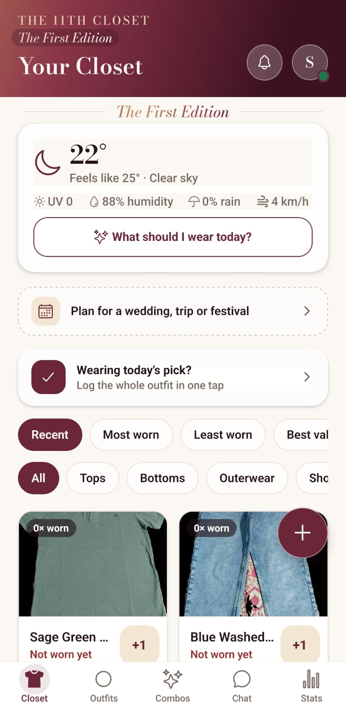
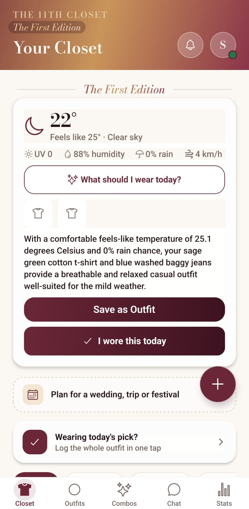
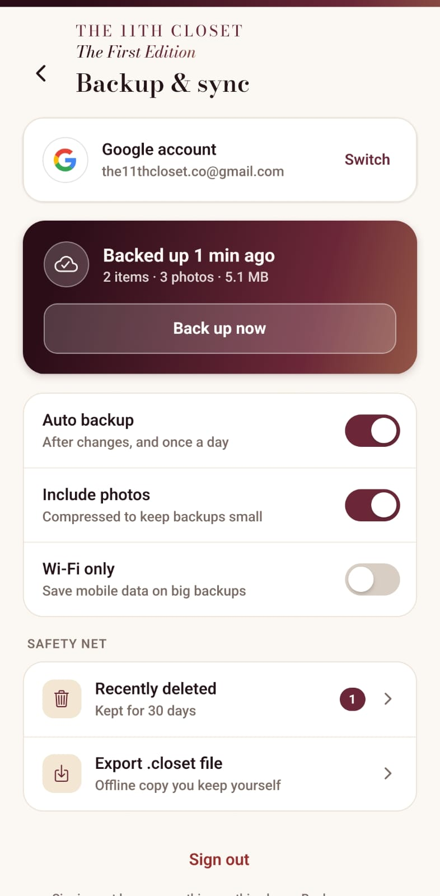
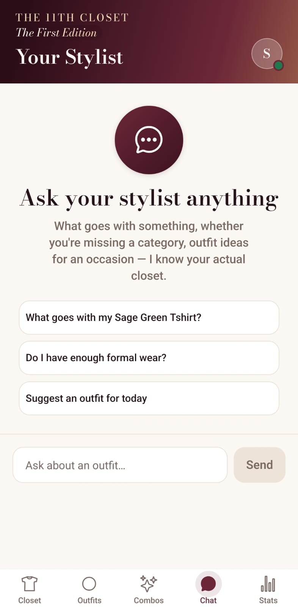
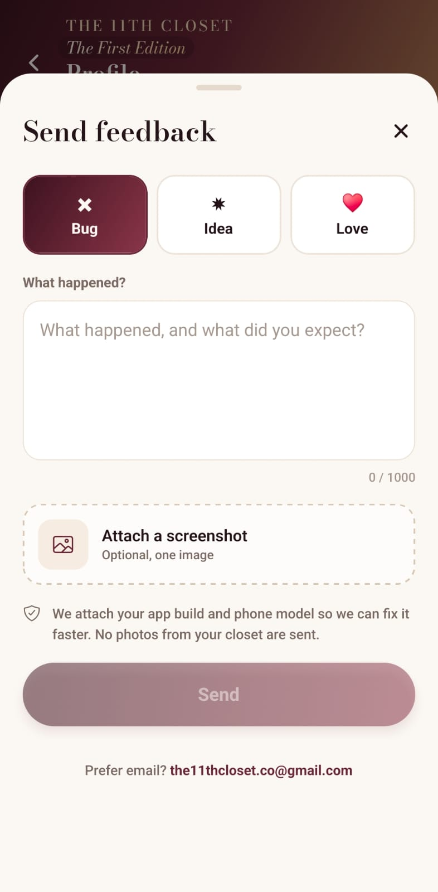
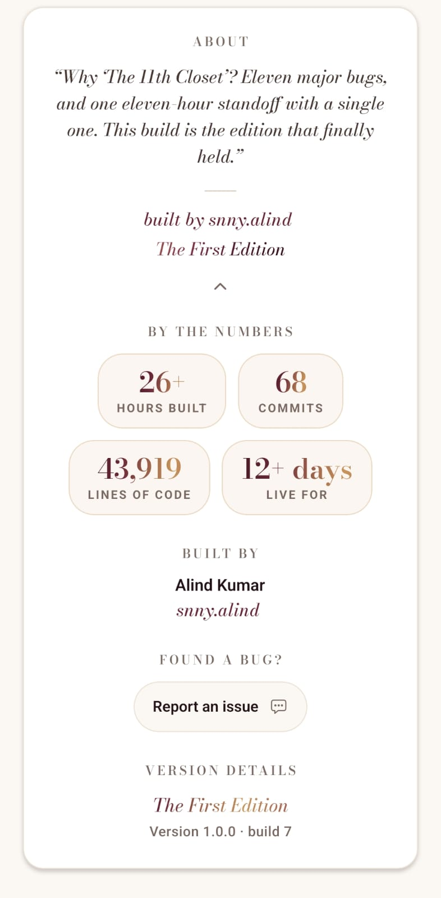

# The 11th Closet
### The First Edition

**Snap your clothes. Build outfits. Get styled by AI.**

[**Live app**](https://theeleventhcloset.auto-tag.workers.dev) · [**Architecture**](docs/ARCHITECTURE.md) · [**Instagram**](https://instagram.com/the11thcloset.co)

[**Watch Demo Video**](assets/trailer.mp4) · [**View The Lookbook (PDF)**](assets/lookbook.pdf)

> 📌 **Showcase repository.** The app's source code is private. This repo shows what the app does, how it fits together at a high level, and what I learned building it.

---

  
  
  
  

## At a glance

| 3 | 2 | 68 | ~26 h | 43,000+ |
|:-:|:-:|:-:|:-:|:-:|
| platforms | apps | commits | build time | lines of code |

*Built from 20 Sept 2026, live in a closed members' circle. Figures as of 26 Sept 2026, across the app and its private admin companion.*

---

## Features

| | |
|---|---|
| 📸 **Snap and tag** | Take a photo. AI tags the item and cuts out the background. |
| 👗 **Outfit builder** | Mix tops, bottoms and shoes with a live colour-harmony meter. |
| ⭐ **Rated like a stylist** | Every outfit gets a score and a reason. |
| 💬 **AI stylist chat** | Knows your wardrobe and today's weather. |
| 📅 **Event planner** | Plan looks for a wedding or a trip, with an automatic packing list. |
| 📊 **Know your wardrobe** | Closet value, cost per wear, most-worn pieces, items that need some love. |
| 🎁 **Monthly Wrapped** | A shareable recap of your month in clothes. |
| 🧠 **Learns your taste** | Likes and skips tune future suggestions. |
| 🎨 **Adaptive themes** | Colours that follow your clothes, plus 5 hand-made themes. |
| 👨‍👩‍👧 **Whole family** | Separate profiles in one app. |
| 🗑️ **Safety net** | A 30-day "recently deleted" bin. |
| ☁️ **Your data, your Drive** | Optional Google sign-in with backup to *your own* Drive, plus .closet file export. |

---

## More screens

  
  
  
  

<!-- OPTIONAL: themes strip. Add assets/10-themes.png, then remove these comment markers.

-->

### Built-in proof

The app shows its own build stats in the About card.

  

---

## Accomplishments

- 🚀 **Shipped a real product** to real users in a closed members' circle
- 📱 **One codebase, three platforms:** Android, web and iPhone home-screen app
- 🛠️ **Built two apps:** the user app and a private admin companion for Android and Windows
- 🔔 **Production features:** push notifications, over-the-air updates, in-app feedback with screenshots and crash reports
- ⚡ **Faster AI:** cut photo processing from about 12 seconds to 1–3 seconds
- 🧪 **Quality:** 84 automated tests in the companion app, plus code reviews before release
- 🐛 **11 major bugs** found and fixed before the first public preview
- 📚 **Documentation:** a 22-page build book and a 3-page member booklet, [The Lookbook (PDF)](assets/lookbook.pdf)
- 🎬 **Brand and launch:** logo, edition naming, launch trailers and festival promo posters (made with AI-assisted tools)

---

## Stack at a glance

| Layer | Tech |
|---|---|
| App | React Native + Expo, one codebase for Android, web and iPhone home-screen app |
| Language | TypeScript |
| Data | On-device SQLite (local-first) |
| AI | Google Gemini, called through a small cloud proxy so no API key ships in the app |
| Cloud | Cloudflare Workers |
| Builds | EAS (Android APK), Cloudflare (web) |

More in [docs/ARCHITECTURE.md](docs/ARCHITECTURE.md).

---

## Design language

Burgundy, copper and cream with glass cards and an animated gradient header. Display type is Bodoni Moda. Every screen carries the full brand line, "The 11th Closet · The First Edition".

---

## Build journey

| When | Milestone |
|---|---|
| 20 Sept 2026 | First commit |
| 23 Sept | **Preview Model I:** first shareable build on Android, web and iPhone |
| 24–25 Sept | Backup, wear log and value tracking, themes, admin companion app, push notifications |
| 25–26 Sept | Event planner, Wrapped, style profile, in-app feedback, crash reports |
| 27 Sept | **The First Edition** goes to the members' circle |

---

## Challenges and what I learned

| Challenge | Result |
|---|---|
| A real database in the browser | One local-first data layer on phone and web, with a friendly recovery screen if the browser blocks storage |
| iPhone home-screen app quirks | Handled behaviours that differ from Safari; smoother iPhone sign-in is planned for The Second Edition |
| Free AI quotas | Fallbacks and fair daily limits, with a friendly "That's all for today" message |
| Slow photo processing | About 12 s down to 1–3 s |
| Updating phones I can't touch | Over-the-air updates for app changes; new builds only when needed |
| Catching bugs before users do | Reviews and fixes before every release |

---

## Roadmap

- **The Second Edition:** smoother iPhone sign-in, member reviews and more
- Google Play release

---

## About the builder

**Alind Kumar** (`snny.alind`), student developer from Ranchi, India.
I build apps for real users and local businesses. This project was built with AI-assisted tools (Claude Code); I drive the design, decisions, testing and releases myself.

- GitHub: [@NXBAURA](https://github.com/NXBAURA)
- Instagram: [@the11thcloset.co](https://instagram.com/the11thcloset.co)
- Email: the11thcloset.co@gmail.com
- LinkedIn: [Alind Kumar](https://www.linkedin.com/in/alind-kumar-08b436441/)

---

All rights reserved. See [LICENSE](LICENSE). No source code, credentials or internal configuration are included in this repository.
