

# The 11th Closet
### The Second Edition

**Your wardrobe, planned for the days ahead.**
 A local-first closet with an AI stylist, a festival calendar and a new look.

**Launch date: 30 Oct 2026 · 1 PM IST**

[**Live app**](https://theeleventhcloset.auto-tag.workers.dev) · [**What's new**](#whats-new-since-the-first-edition) · [**Architecture**](docs/ARCHITECTURE.md) · [**Instagram**](https://instagram.com/the11thcloset.co)

**Editions:** **Second (current)** · [First](editions/first-edition/README.md)

> 📌 **Showcase repository.** The app's source code is private. This page shows what each edition does, how it fits together at a high level, and what I learned building it.

> 🎬 **The Second Edition trailer and Lookbook** are on their way and will be added here.

---

  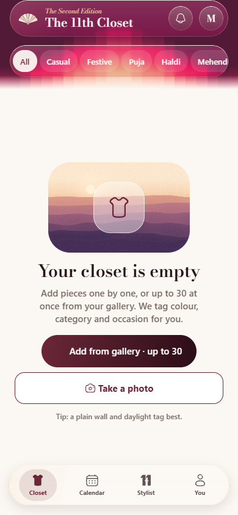
  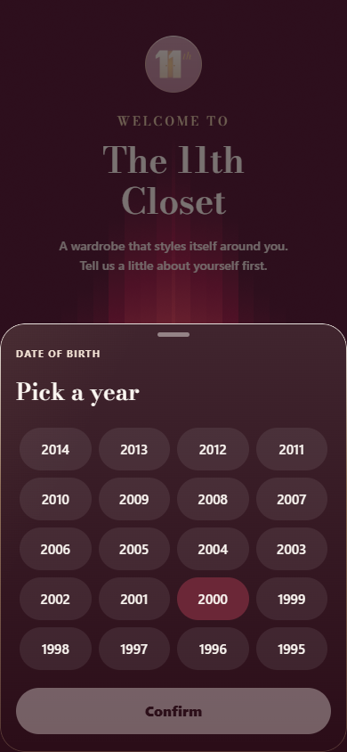
  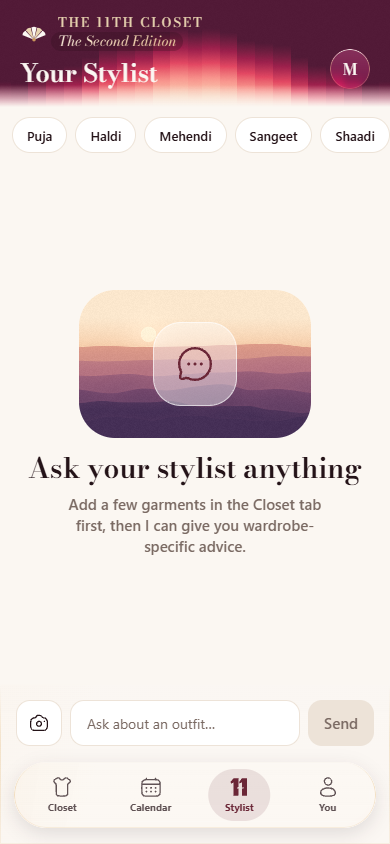
  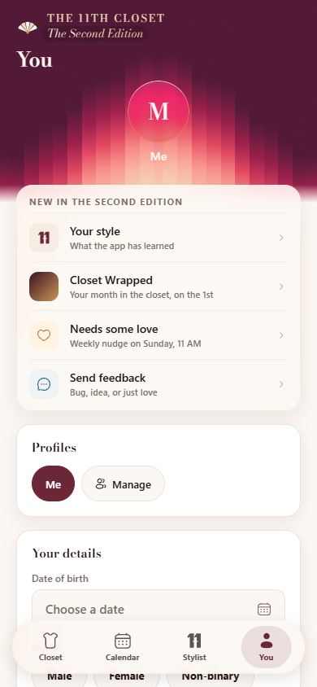
  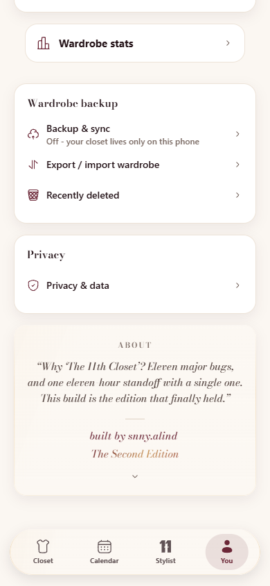

## At a glance

| 2 | 3 | 97 | 91,000+ | 1,150+ |
|:-:|:-:|:-:|:-:|:-:|
| editions | platforms | commits | lines of code | automated tests |

*Across the app and its private owner companion, as of 29 Oct 2026. Tests: 677 app, 210 control server, 96 AI server, 51 companion app, 118 end-to-end runs.*

---

## What's new since the First Edition

| | The First Edition | The Second Edition |
|---|---|---|
| **Planning** | Event planner with a packing list | A full calendar (month, week, trips) with Indian festivals and looks planned for each day |
| **Adding clothes** | One photo at a time | Mass upload: pick many photos, a background queue tags them, then you review |
| **Stylist** | Text chat | Send a photo of an accessory and get 3 looks built around it, plus outfits for each occasion |
| **Memory** | Likes and skips | The stylist remembers what you tell it, and you can see and edit what it remembers |
| **Look** | 5 themes and an animated header | 14 themes, moving gradient "looks" and glass surfaces |
| **Sign-in on iPhone** | Same as Safari | A one-time link code that moves sign-in from Safari to the home-screen app |
| **Getting your closet back** | Manual restore | A "Bring your closet back" prompt: Drive backup, this phone's backup or a .closet file |
| **Brand** | Wordmark | The new Pleat Fan mark, with a switch in settings to pick your app logo |
| **Privacy** | Short policy | A new privacy policy, terms and delete-account page, with a consent screen on first launch |
| **Behind the scenes** | Admin companion app | Fleet view, safe rollouts, AI limits and a kill switch in the owner control app |

---

## Features

| | |
|---|---|
| 📅 **Calendar and festivals** | Month and week views, trips with day-by-day looks, and festival cards for Durga Puja, Diwali, Chhath, Christmas and more. |
| 📸 **Mass upload** | Add a whole shelf at once. A progress pill keeps going while you use the app, spots duplicates and skips failed photos. |
| 💬 **Stylist with photos** | Attach a photo to the chat. Accessory photos come back as 3 complete looks. |
| 🧠 **Stylist memory** | Things like "I don't wear yellow" are saved as notes that stay on your phone. |
| 🎵 **Soundtrack** | Pin a song to an outfit. The song link stays on your phone. |
| 🌦️ **City and weather** | Pick your city and state for local weather and festival dates. |
| 🔔 **Gentle notifications** | Festival and plan reminders that you can turn off. |
| 🪟 **Glass and gradients** | Glass tab bar, sheets and cards over moving gradient looks, with pull-to-refresh on the Pleat mark. |
| 📱 **Home-screen widget** | Today's look on your Android home screen. |
| 👗 **Everything from the First Edition** | Snap and tag, outfit builder, ratings, stats, Wrapped, family profiles, the 30-day bin and Drive backup. |

---

## Looks

Fourteen themes, from the house *Burgundy & Gold* to the new *Deep sea*, *Blue sky*, *Lagoon*, *Emerald* and *Orchid*, plus festive sets like *Zari Noir* and *Banarasi Rose*.

  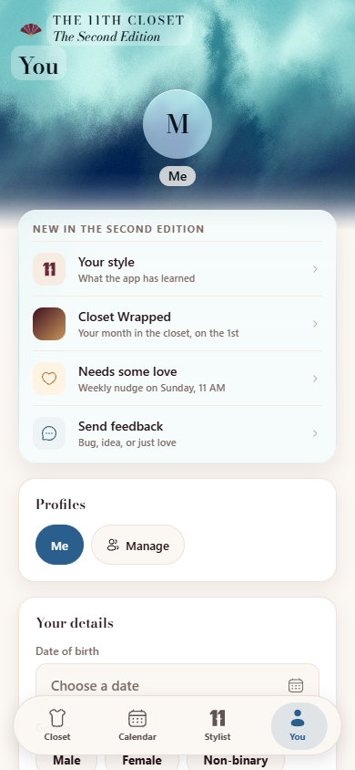
  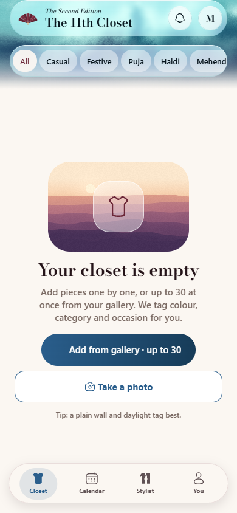
  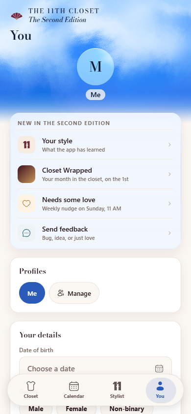
  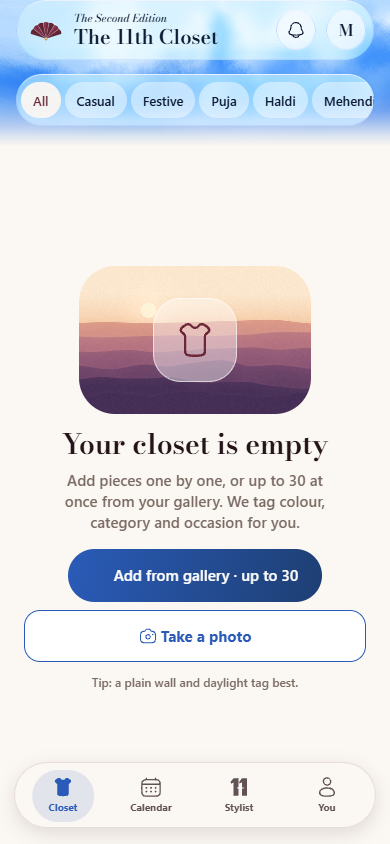

Display type is Bodoni Moda; body type is DM Sans.

---

## The Pleat Fan mark

The Second Edition has a new brand mark: a fan of pleats that opens on launch, spins while the app is thinking and closes when you're offline.

  
  &nbsp;&nbsp;
  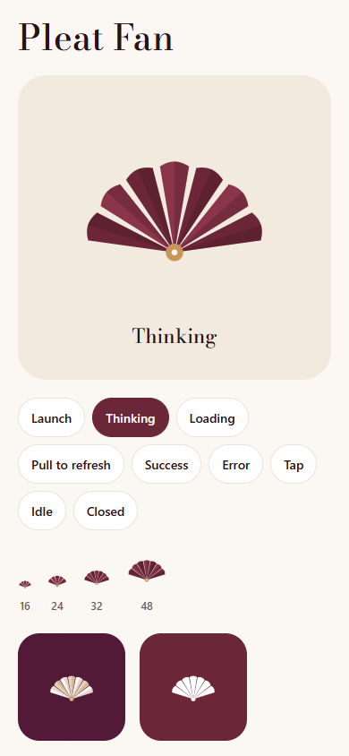

---

## Privacy, built in

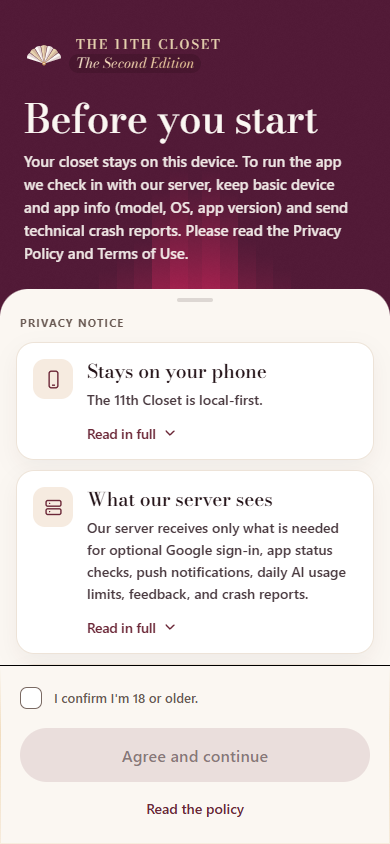

- **Local-first.** Your closet, photos, outfits, prices, wear history, calendar, stylist notes, songs and city stay on your device.
- **Your own backup.** Optional backup goes to a hidden app folder in *your* Google Drive.
- **Photos are processed, not stored.** AI photos pass through the server to Gemini and are not kept.
- **Weather without tracking.** Your approximate location goes straight to the weather service, never to the app's server.
- **No ads, no selling data.** You can see, fix or delete your data at any time, including deleting your whole account.

Read the live [Privacy Policy](https://theeleventhcloset.auto-tag.workers.dev/privacy) and [Terms](https://theeleventhcloset.auto-tag.workers.dev/terms).

 

---

## Stack at a glance

| Layer | Tech |
|---|---|
| App | React Native + Expo SDK 57, one codebase for Android, web and the iPhone home-screen app |
| Language | TypeScript |
| Data | On-device SQLite (local-first) |
| AI | Google Gemini, called through a small cloud proxy so no API key ships in the app |
| Cloud | Cloudflare Workers and D1, for AI limits, app status checks and the owner control app |
| Owner app | A private companion for Android and Windows |
| Builds | EAS (Android APK), over-the-air updates, Cloudflare (web) |

More in [docs/ARCHITECTURE.md](docs/ARCHITECTURE.md).

---

## Build journey

| When | Milestone |
|---|---|
| 20 Sept 2026 | First commit |
| 27 Sept | **The First Edition** goes to the members' circle |
| 14 Oct | Security and data-safety review: backups, imports, sign-out and the network layer hardened |
| 16 Oct | Second Edition, phase 1: new backend for AI limits, festivals and the control app |
| 22 Oct | Phase 2: calendar and festivals, mass upload, chat photos, new look, legal pages |
| 23–28 Oct | Soundtrack, iPhone link sign-in, restore prompt, home widget, liquid glass |
| 28–29 Oct | Pleat Fan mark, new legal pages, sky looks and launch fixes |
| 30 Oct | **The Second Edition** goes to members |

---

## Challenges and what I learned

| Challenge | Result |
|---|---|
| Rolling out to phones I can't touch | Status checks, a minimum-build setting and a kill switch so a bad release can be stopped from the control app |
| Fair AI limits that can't be faked | Limits are set by the server, not by the app |
| Many photos at once | A background queue with retries, duplicate checks and a clear daily limit |
| iPhone home-screen sign-in | A short-lived, one-time code that hands sign-in from Safari to the app |
| Glass that stays smooth | Blur and gradients tuned to keep scrolling smooth, with plain fallbacks |
| Privacy promises that hold | The privacy promises are checked by automated tests and a security review |
| Catching bugs before members do | 1,150+ automated tests and a full end-to-end run before each release |

---

## Roadmap

- Google Play release
- More festival and regional looks
- **The Third Edition**

---

## About the builder

**Alind Kumar** (`snny.alind`), student developer from Ranchi, India.
I build apps for real users and local businesses, and I drive the design, decisions, testing and releases myself.

- GitHub: [@NXBAURA](https://github.com/NXBAURA)
- Instagram: [@the11thcloset.co](https://instagram.com/the11thcloset.co)
- Email: the11thcloset.co@gmail.com
- LinkedIn: [Alind Kumar](https://www.linkedin.com/in/alind-kumar-08b436441/)

---

Past editions: [The First Edition](editions/first-edition/README.md) (27 Sept 2026), with its [trailer](assets/first-edition/trailer.mp4) and [Lookbook (PDF)](assets/first-edition/lookbook.pdf).

All rights reserved. See [LICENSE](LICENSE). No source code, credentials or internal configuration are included in this repository.
