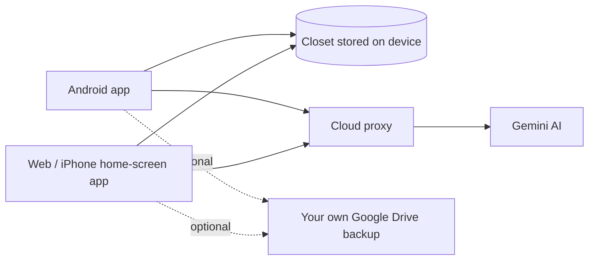
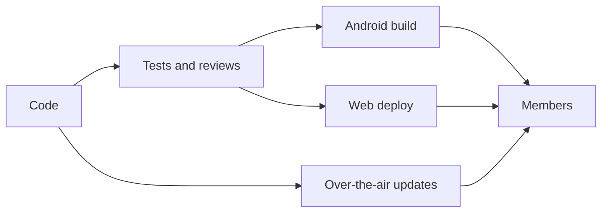

# Architecture (high level)

A simplified overview. Internals are intentionally left out.

## How it fits together

## How it ships

## Design principles

1. **Local-first.** Your closet lives on your device and works without a server for everyday use.
2. **No keys in the app.** AI calls go through a cloud proxy, so nothing sensitive ships to phones.
3. **You own your backups.** Optional backup goes to the user's own Google Drive, not mine.
4. **One codebase, three platforms.** Android, web and the iPhone home-screen app share the same code.
5. **Fair use of free AI.** Fallbacks and daily limits keep the app running for everyone.
6. **Ship safely.** Tests and reviews before every release; small fixes go out over the air.

## What's intentionally not here

Source code, configuration, keys, deployment details and internal mechanisms.
