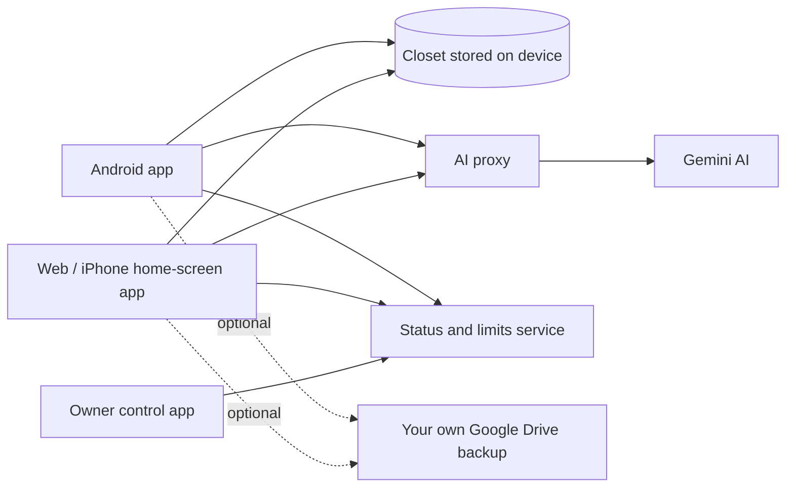
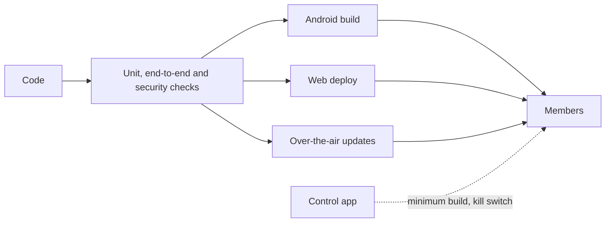

# Architecture (high level)

A simplified overview of The Second Edition. Internals are intentionally left out.

## How it fits together

- **The closet lives on the device.** Clothes, photos, outfits, calendar, stylist notes and songs never need a server.
- **The AI proxy** sends photos and text to Gemini and keeps nothing.
- **The status and limits service** handles daily AI limits, app status checks, push notifications, feedback and crash reports.
- **The owner control app** (Android and Windows) shows which builds are in use and controls rollouts, AI limits and the kill switch.

## How it ships

## Design principles

1. **Local-first.** Your closet lives on your device and works without a server for everyday use.
2. **No keys in the app.** AI calls go through a cloud proxy, so nothing sensitive ships to phones.
3. **You own your backups.** Optional backup goes to the user's own Google Drive, not mine.
4. **The server sets the limits.** AI limits come from the server, so the app can't change them.
5. **Keep as little as possible.** Photos are processed, not stored. Song links, city and stylist notes stay on the phone.
6. **One codebase, three platforms.** Android, web and the iPhone home-screen app share the same code.
7. **Ship safely.** Tests before every release, small fixes over the air, and a way to stop a bad release.

## What's intentionally not here

Source code, configuration, keys, account details, deployment details and internal mechanisms.
